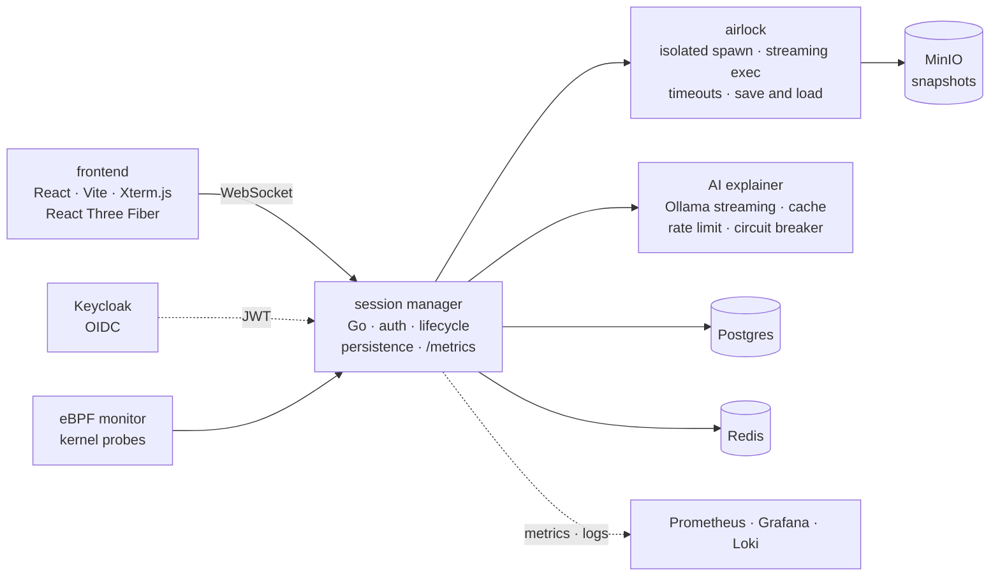

<p align="center">
  
</p>

<p align="center">
  <b>Run the command you are not supposed to run. Watch what it does. Then hear why.</b><br>
  <sub>A chaos-engineering sandbox: an isolated container, a live terminal, a picture of the system's health as it falls over, and an AI that explains the root cause when it does.</sub>
</p>

<p align="center">
  <sub>
    <a href="#overview">OVERVIEW</a> &nbsp;·&nbsp;
    <a href="#quick-start">QUICK START</a> &nbsp;·&nbsp;
    <a href="#a-session">A SESSION</a> &nbsp;·&nbsp;
    <a href="#labs">LABS</a> &nbsp;·&nbsp;
    <a href="#isolation">ISOLATION</a> &nbsp;·&nbsp;
    <a href="#the-services">THE SERVICES</a> &nbsp;·&nbsp;
    <a href="#run-it">RUN IT</a> &nbsp;·&nbsp;
    <a href="#host-it-for-free">HOST IT FOR FREE</a> &nbsp;·&nbsp;
    <a href="#status">STATUS</a>
  </sub>
</p>

<br>

<table>
  <tr>
    <td><sub>BACKEND</sub><br><b>Go, four services</b></td>
    <td><sub>FRONTEND</sub><br><b>React, Xterm.js, R3F</b></td>
    <td><sub>INCIDENTS</sub><br><b>15, each proven solvable</b></td>
    <td><sub>AI</sub><br><b>Ollama, local</b></td>
    <td><sub>HOSTING COST</sub><br><b>A free Linux VM</b></td>
  </tr>
</table>

## Overview

Entropy is a chaos-engineering sandbox and an incident trainer. You get a real terminal inside a disposable machine, often one that has been broken on purpose, and you watch the consequences live.

When something fails, an AI explains the root cause: not "an error occurred", but which file disappeared and why everything after it fell over.

> [!IMPORTANT]
> Entropy runs arbitrary root commands from anonymous users. Before exposing it publicly, install gVisor and set `SANDBOX_RUNTIME=runsc`, so sandboxes refuse to start without a kernel boundary.

## Quick start

```bash
docker compose up --build
open http://localhost:3000
```


## A session

1. Sign in through Keycloak, or start as a guest, and get a fresh sandbox: an isolated container capped at 256 MB, half a CPU and 100 processes, with no network at all.
2. Type into a real terminal. `rm -rf /usr/lib`, a fork bomb, filling the disk, killing PID 1. Whatever you were always told not to do.
3. Watch it happen. eBPF probes on the host see process, file and network events as they occur, and the system-health view reacts in real time.
4. When the sandbox breaks, the AI explainer reads what happened and streams back a root-cause explanation: not "an error occurred", but which file disappeared and why everything after it failed.
5. Snapshot an interesting failure (the container filesystem is committed, compressed and stored in MinIO) and restore it into a fresh container later. Snapshots expire after 30 days.

## Labs

The workspace is built around guided incident labs, worked in a real interactive terminal (vim, top and job control all work) next to a live process tree.

**The sandbox is broken on purpose.** A CPU hog disguised as a kernel thread. A deleted log file still holding `/var/log`. PID exhaustion, zombies, permission bugs, a memory leak, a port conflict. Objectives check themselves after every command, with hints and a debrief built in. Every incident is verified solvable in Docker under the same limits a learner gets.

**A production stack** of proxy, app and database under live traffic, where incidents (502s, slow queries, pool exhaustion, log floods) are judged against SLOs, not against a checklist.

| Mode | |
|---|---|
| Practice | hints and the AI explainer |
| Interview | timed, graded A to F |
| Game day | three incidents, one shared error budget |

Every session can become a **postmortem** and a **shareable replay** built from the recorded timeline. Labs are a JSON spec, so the community can write them, and an AI can generate them, but nothing is published until `labctl validate` proves in a sandbox that the setup breaks the system and the reference fix repairs it.

## Isolation

Entropy runs arbitrary root commands from anonymous users, so every sandbox is treated as hostile.

| Layer | Setting |
|---|---|
| Kernel boundary | gVisor (`runsc`); with `SANDBOX_RUNTIME=runsc` sandboxes refuse to start without it |
| Capabilities | drop all; add back only `CHOWN`, `SETUID`, `SETGID` |
| Privilege escalation | `no-new-privileges` |
| Resources | 256 MB, no swap, half a CPU, 100 PIDs, file and size limits |
| Network | none; lab stacks get a private internal network with no egress |
| Filesystems | `/tmp` and `/var/log` as `noexec`, `nosuid` tmpfs |
| WebSocket | origin allowlist |

## The services



| Service | Responsibility |
|---|---|
| **Session manager** | HTTP and WebSocket gateway, OIDC JWT validation, session lifecycle, persistence, Prometheus metrics |
| **Airlock** | Isolated Docker spawn, streaming exec, timeout signalling, statistics, image save and load |
| **AI explainer** | Streaming explanations from a local Ollama model, with caching, rate limiting, a circuit breaker, and deterministic fallbacks when the model is unavailable |
| **eBPF monitor** | Real kernel probes on Linux, and a local simulator emitting the identical event shape everywhere else |

Exactly four backend services, by rule. Postgres holds sessions, Redis holds the ephemeral state, MinIO holds snapshots, and Prometheus, Grafana, Loki and Promtail watch all of it.

## Run it

Docker and Docker Compose. Go 1.26+ and Node 20+ only for working on a service natively.

```bash
docker compose up --build
```

Open **http://localhost:3000**.

| Port | Service |
|---|---|
| `3000` | The app (nginx, proxying `/health`, `/api`, `/ws`) |
| `8082` | Session manager |
| `8087` | Keycloak |
| `3001` | Grafana |
| `9090` | Prometheus |
| `3100` | Loki |

```bash
curl -i http://127.0.0.1:3000/health
curl -i -H 'X-Guest: 1' http://127.0.0.1:3000/api/session/new
curl -i http://127.0.0.1:8082/metrics
```

On a Linux host, switch from the simulator to real kernel probes:

```bash
EBPF_SIMULATOR_MODE=false EBPF_PRIVILEGED=true \
  docker compose -f docker-compose.yml -f docker-compose.linux.yml up -d --build
```

<details>
<summary><b>Frontend development with Vite</b></summary>
<br>

```bash
docker compose up --build
cd frontend && npm install && npm run dev
```

Open `http://127.0.0.1:5175`. Vite proxies `/api` and `/ws` to the session manager on `127.0.0.1:8082`.

</details>

## Host it for free

The target deployment is one free Linux VM running the same Compose stack, with real eBPF, exposed through a Cloudflare Tunnel. No paid cloud services, no Kubernetes.

| Runbook | What it covers |
|---|---|
| [`docs/vm-deploy.md`](docs/vm-deploy.md) | The VM, from bare to running |
| [`docs/linux-ebpf.md`](docs/linux-ebpf.md) | Real probes on a real kernel |
| [`docs/your-actions.md`](docs/your-actions.md) | Every operator step: VM, tunnel, Keycloak redirects, acceptance |
| [`docs/production-inputs.md`](docs/production-inputs.md) | The inputs it needs, one at a time |
| [`docs/local-ops.md`](docs/local-ops.md) | Local checks |

## Status

Built in staged changes, one roadmap stage at a time. **P14** is complete locally: gVisor runtime selection, the interactive terminal, 15 incidents across starters, system and production-stack labs, postmortems and replays, interview mode and game day, and CI covering Go race tests, the frontend build, lab validation in Docker and Playwright end-to-end tests. Before public launch: gVisor installed on the VM and `SANDBOX_RUNTIME=runsc`, then the free-VM acceptance pass. [`STATUS.md`](STATUS.md) is the live record.

<details>
<summary><b>Repository layout</b></summary>
<br>

```
services/     session-manager · airlock · ai-explainer · ebpf-monitor
pkg/          shared contracts, clients, persistence, auth, resilience
frontend/     React + Vite
docs/         requirements, design, architecture, operations, decisions
issues/       backlog and templates
infra/, k8s/  the older AWS packaging, optional
```

</details>
