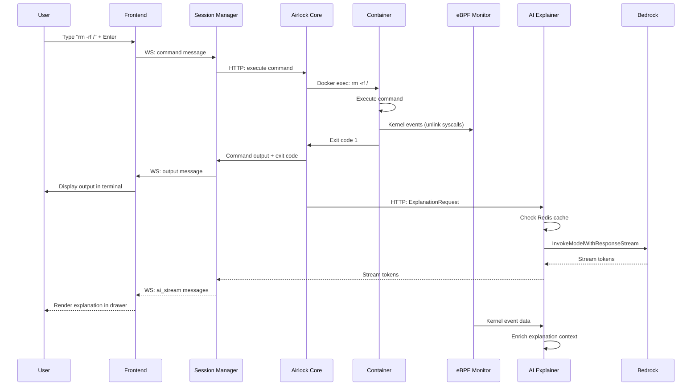

# Design Document: Entropy Chaos Engineering Sandbox

## 1. Introduction

Entropy is an AI-powered chaos engineering sandbox that enables developers to safely execute dangerous system commands in isolated container environments. The system combines real-time kernel-level observability through eBPF, generative AI explanations via Amazon Bedrock, and interactive 3D visualizations to transform catastrophic failures into educational experiences.

This design document specifies the technical architecture for a distributed system handling 100 concurrent containerized sessions, each with bidirectional WebSocket communication, eBPF-based failure detection, and streaming AI analysis. The architecture prioritizes security isolation, sub-second response latency, and horizontal scalability on AWS infrastructure.

## 2. Design Goals

### Primary Goals

1. **Security Isolation**: Guarantee complete container isolation preventing escape to host system or cross-session contamination
2. **Sub-Second Responsiveness**: Deliver terminal output within 100ms and AI explanation first token within 500ms
3. **Failure Observability**: Capture kernel-level events (OOM kills, kernel panics, segfaults) with sub-100ms latency
4. **Educational Value**: Generate contextual AI explanations that teach root cause analysis and remediation
5. **Horizontal Scalability**: Support scaling from 100 to 1000 concurrent sessions through infrastructure changes only

### Secondary Goals

1. **Cost Efficiency**: Maintain per-session cost under $0.10 including compute, storage, and AI inference
2. **Operational Simplicity**: Enable zero-downtime deployments and automated failure recovery
3. **Data Persistence**: Preserve session history and snapshots with 99.999999999% durability
4. **Developer Experience**: Provide intuitive interface requiring under 5 minutes to first command execution


## 3. High-Level Architecture Overview

Entropy follows a layered architecture with clear separation between presentation, communication, execution, and infrastructure concerns:

```
┌─────────────────────────────────────────────────────────────────┐
│                     Frontend Layer (React)                       │
│  ┌──────────────┐  ┌──────────────┐  ┌─────────────────────┐  │
│  │  Xterm.js    │  │ Three.js 3D  │  │  AI Chat Drawer     │  │
│  │  Terminal    │  │ Visualization│  │  (Markdown)         │  │
│  └──────────────┘  └──────────────┘  └─────────────────────┘  │
│                    AWS Amplify + CloudFront CDN                 │
└─────────────────────────────────────────────────────────────────┘
                              │
                    WebSocket (Gorilla)
                              │
┌─────────────────────────────────────────────────────────────────┐
│                    Backend Core (Go Services)                    │
│  ┌──────────────────┐  ┌──────────────────┐  ┌──────────────┐ │
│  │ Session Manager  │  │  Airlock Core    │  │ AI Explainer │ │
│  │ (Lifecycle)      │  │  (Exec Engine)   │  │ (Bedrock)    │ │
│  └──────────────────┘  └──────────────────┘  └──────────────┘ │
│                    Amazon EKS (Kubernetes)                       │
└─────────────────────────────────────────────────────────────────┘
                              │
        ┌─────────────────────┼─────────────────────┐
        │                     │                     │
┌───────▼────────┐  ┌─────────▼────────┐  ┌────────▼─────────┐
│   Container    │  │  eBPF Monitor    │  │  Persistence     │
│  Orchestrator  │  │  (Kernel Trace)  │  │  Layer           │
│   (Docker)     │  │                  │  │  RDS + S3        │
└────────────────┘  └──────────────────┘  └──────────────────┘
```

### Architecture Principles

1. **Stateless Backend Services**: All session state stored in PostgreSQL, enabling horizontal scaling without sticky sessions
2. **Event-Driven Communication**: WebSocket messages trigger asynchronous workflows (command execution, AI generation, snapshot creation)
3. **Defense in Depth**: Multiple isolation layers (namespaces, cgroups, seccomp, network policies) prevent container escape
4. **Fail-Fast with Graceful Degradation**: AI failures fall back to raw error messages; visualization failures don't block terminal functionality


## 4. Component Architecture

### 4.1 Frontend Layer

**Technology Stack**: React 18, Vite, Xterm.js 5.x, React-Three-Fiber, WebSocket API

**Responsibilities**:
- Render interactive terminal interface with ANSI color support
- Manage WebSocket connection lifecycle with automatic reconnection
- Render 3D server visualization with failure animations
- Display streaming AI explanations in Markdown format
- Handle user authentication flow with AWS Cognito

**Key Components**:

**Terminal Component (Xterm.js)**:
- Occupies 60% viewport width in split-pane layout
- Maintains local command history buffer (last 100 commands)
- Implements custom key bindings for Ctrl+C (SIGINT), Ctrl+D (EOF)
- Streams stdout/stderr incrementally as WebSocket messages arrive
- Displays exit codes inline for non-zero returns

**3D Visualization Component (React-Three-Fiber)**:
- Occupies 40% viewport width with WebGL renderer
- Maintains 60 FPS through requestAnimationFrame loop
- Implements state machine: HEALTHY (green cube) → ERROR (red cube) → CRASHED (explosion particles)
- Subscribes to system health events via WebSocket
- Uses instanced rendering for particle effects (OOM shake, kernel panic explosion)

**AI Chat Drawer**:
- Collapsible bottom panel (300px height when expanded)
- Renders Markdown with syntax highlighting for code blocks
- Streams tokens incrementally as they arrive from Bedrock
- Maintains conversation history (last 10 explanations per session)
- Auto-scrolls to latest content during streaming

**WebSocket Manager**:
- Establishes connection to `wss://api.entropy.dev/ws?sessionId={uuid}`
- Implements exponential backoff reconnection (1s, 2s, 4s max 3 attempts)
- Sends heartbeat pings every 30 seconds
- Multiplexes message types: `command`, `output`, `visualization`, `ai_stream`, `heartbeat`
- Handles connection state: CONNECTING → OPEN → RECONNECTING → CLOSED

### 4.2 WebSocket Layer

**Technology**: Gorilla WebSocket library (Go)

**Connection Lifecycle**:
1. Client initiates WebSocket upgrade request with session ID query parameter
2. Backend validates session ID exists in PostgreSQL
3. Gorilla upgrades HTTP connection to WebSocket protocol
4. Backend associates WebSocket connection with session in memory map
5. Backend spawns goroutine for reading client messages
6. Backend spawns goroutine for writing server messages

**Message Protocol**:

All messages use JSON format with discriminated union pattern:

```json
{
  "type": "command" | "output" | "visualization" | "ai_stream" | "heartbeat",
  "sessionId": "uuid-v4",
  "timestamp": "RFC3339",
  "payload": { /* type-specific data */ }
}
```

**Command Message** (Client → Server):
```json
{
  "type": "command",
  "sessionId": "550e8400-e29b-41d4-a716-446655440000",
  "payload": {
    "command": "rm -rf /",
    "executionType": "interactive" | "scenario"
  }
}
```

**Output Message** (Server → Client):
```json
{
  "type": "output",
  "sessionId": "550e8400-e29b-41d4-a716-446655440000",
  "payload": {
    "stdout": "removing files...\n",
    "stderr": "",
    "exitCode": 0,
    "completed": false
  }
}
```

**Visualization Message** (Server → Client):
```json
{
  "type": "visualization",
  "sessionId": "550e8400-e29b-41d4-a716-446655440000",
  "payload": {
    "status": "healthy" | "error" | "crashed",
    "event": "oom_kill" | "kernel_panic" | "segfault" | null
  }
}
```

**AI Stream Message** (Server → Client):
```json
{
  "type": "ai_stream",
  "sessionId": "550e8400-e29b-41d4-a716-446655440000",
  "payload": {
    "token": "The kernel panic occurred because...",
    "done": false
  }
}
```

**Concurrency Model**:
- Each WebSocket connection handled by dedicated goroutine pair (reader + writer)
- Writer goroutine reads from buffered channel (capacity 100 messages)
- Reader goroutine blocks on `conn.ReadMessage()` until client sends data
- Session Manager maintains `map[sessionID]*websocket.Conn` with RWMutex protection
- Maximum 100 concurrent connections enforced by semaphore


### 4.3 Backend Core (Go Services)

**Technology Stack**: Go 1.21+, Gorilla WebSocket, AWS SDK Go v2, Docker SDK

**Service Architecture**: Three primary services running as separate deployments on EKS:

#### Session Manager Service

**Responsibilities**:
- Generate unique session IDs (UUID v4)
- Orchestrate container lifecycle (create, monitor, terminate)
- Manage WebSocket connection registry
- Enforce concurrent session limits (100 max)
- Implement idle timeout detection (5 minutes)
- Handle snapshot creation and restoration

**Key Data Structures**:

```go
type Session struct {
    ID            string
    UserID        string // empty for guest sessions
    ContainerID   string
    WebSocketConn *websocket.Conn
    CreatedAt     time.Time
    LastActivity  time.Time
    Status        SessionStatus // CREATING, ACTIVE, IDLE, TERMINATING
}

type SessionRegistry struct {
    sessions map[string]*Session
    mu       sync.RWMutex
    semaphore chan struct{} // capacity 100
}
```

**Session Creation Flow**:
1. Receive session creation request via HTTP POST `/api/sessions`
2. Acquire semaphore slot (blocks if 100 sessions active)
3. Generate UUID v4 session ID
4. Insert session record into PostgreSQL with status CREATING
5. Call Docker API to spawn container with resource limits
6. Wait for container health check (max 3 seconds)
7. Update session status to ACTIVE in PostgreSQL
8. Return session ID to client

**Idle Timeout Detection**:
- Background goroutine runs every 30 seconds
- Scans all ACTIVE sessions for `time.Since(LastActivity) > 5 minutes`
- Marks idle sessions for termination
- Sends graceful shutdown signal to container (SIGTERM)
- Waits 5 seconds then sends SIGKILL if still running
- Removes session from registry and updates PostgreSQL

#### Airlock Core Service

**Responsibilities**:
- Execute commands inside isolated containers
- Capture stdout, stderr, and exit codes
- Enforce 30-second command timeout
- Stream output incrementally via WebSocket
- Detect command completion and signal visualization updates

**Command Execution Implementation**:

```go
func (a *Airlock) ExecuteCommand(ctx context.Context, sessionID, command string) error {
    // Create context with 30-second timeout
    execCtx, cancel := context.WithTimeout(ctx, 30*time.Second)
    defer cancel()
    
    // Build docker exec command
    execConfig := types.ExecConfig{
        Cmd:          []string{"/bin/sh", "-c", command},
        AttachStdout: true,
        AttachStderr: true,
        Tty:          false,
    }
    
    // Create exec instance
    execID, err := a.dockerClient.ContainerExecCreate(execCtx, sessionID, execConfig)
    if err != nil {
        return fmt.Errorf("exec create failed: %w", err)
    }
    
    // Attach to exec streams
    resp, err := a.dockerClient.ContainerExecAttach(execCtx, execID.ID, types.ExecStartCheck{})
    if err != nil {
        return fmt.Errorf("exec attach failed: %w", err)
    }
    defer resp.Close()
    
    // Stream output to WebSocket
    go a.streamOutput(sessionID, resp.Reader)
    
    // Wait for completion or timeout
    for {
        select {
        case <-execCtx.Done():
            // Timeout reached, send SIGTERM then SIGKILL
            a.killExec(execID.ID)
            return fmt.Errorf("command timeout after 30s")
        case <-a.execComplete(execID.ID):
            // Command completed naturally
            exitCode := a.getExitCode(execID.ID)
            a.sendExitCode(sessionID, exitCode)
            return nil
        }
    }
}
```

**Output Streaming**:
- Read from Docker exec stdout/stderr pipes in 4KB chunks
- Send each chunk immediately via WebSocket (no buffering)
- Use Docker's multiplexed stream format (8-byte header + payload)
- Demultiplex stdout (stream 1) and stderr (stream 2)
- Send final message with `completed: true` and exit code

**Timeout Enforcement**:
- Use Go context with 30-second deadline
- On timeout, send SIGTERM to process via `docker exec kill`
- Wait 5 seconds for graceful shutdown
- Send SIGKILL if process still running
- Return timeout error to client

#### AI Explainer Service

**Responsibilities**:
- Detect failure conditions triggering explanation (non-zero exit, kernel panic, OOM kill, segfault)
- Construct context payload from command, error, and eBPF data
- Stream explanation tokens from Amazon Bedrock
- Format explanations with root cause, impact, and remediation sections
- Cache common explanations to reduce API costs

**Bedrock Integration**:

```go
type BedrockExplainer struct {
    client *bedrockruntime.Client
    model  string // "anthropic.claude-3-5-sonnet-20241022-v2:0"
}

func (b *BedrockExplainer) GenerateExplanation(ctx context.Context, req ExplanationRequest) error {
    // Construct prompt with failure context
    prompt := b.buildPrompt(req.Command, req.ExitCode, req.ErrorMessage, req.EBPFEvents)
    
    // Build Bedrock request
    input := &bedrockruntime.InvokeModelWithResponseStreamInput{
        ModelId:     aws.String(b.model),
        ContentType: aws.String("application/json"),
        Body: []byte(fmt.Sprintf(`{
            "anthropic_version": "bedrock-2023-05-31",
            "max_tokens": 500,
            "temperature": 0.7,
            "messages": [{
                "role": "user",
                "content": "%s"
            }]
        }`, prompt)),
    }
    
    // Invoke streaming API
    resp, err := b.client.InvokeModelWithResponseStream(ctx, input)
    if err != nil {
        return fmt.Errorf("bedrock invocation failed: %w", err)
    }
    defer resp.GetStream().Close()
    
    // Stream tokens to WebSocket
    for event := range resp.GetStream().Events() {
        switch v := event.(type) {
        case *types.ResponseStreamMemberChunk:
            var chunk BedrockChunk
            json.Unmarshal(v.Value.Bytes, &chunk)
            
            if chunk.Type == "content_block_delta" {
                b.sendToken(req.SessionID, chunk.Delta.Text)
            }
        }
    }
    
    b.sendToken(req.SessionID, "", true) // done signal
    return nil
}
```

**Prompt Engineering**:

Template structure for failure explanations:

```
You are a systems engineering instructor explaining a command failure to a student.

Command executed: {command}
Exit code: {exitCode}
Error message: {stderr}
Kernel events: {ebpfEvents}

Provide a concise explanation covering:
1. Root Cause: What specifically caused this failure?
2. System Impact: What happened to the system?
3. Remediation: How would you fix or prevent this in production?

Keep the explanation under 300 words and use technical terminology appropriate for a CS student.
```

**Caching Strategy**:
- Hash combination of (command, exitCode, errorMessage) using SHA-256
- Check Redis cache for existing explanation (TTL 24 hours)
- If cache hit, stream cached explanation without Bedrock call
- If cache miss, generate new explanation and store in Redis
- Cache only explanations for common failures (exit codes 1, 2, 126, 127, 130, 137, 139)


### 4.4 Container Orchestrator

**Technology**: Docker Engine 24.x with containerd runtime

**Container Specification**:

```yaml
Image: ubuntu:22.04
Resources:
  CPU: 0.5 cores (500 millicores)
  Memory: 256 MB hard limit
  Swap: 0 (disabled)
  PIDs: 100 max processes
Security:
  Namespaces: pid, net, ipc, uts, mount
  Capabilities: DROP ALL, ADD ONLY [CHOWN, DAC_OVERRIDE, SETUID, SETGID]
  Seccomp: default profile with syscall filtering
  AppArmor: docker-default profile
  ReadOnlyRootfs: false (allows file modifications)
  NoNewPrivileges: true
Network:
  Mode: none (no external network access)
  Loopback: enabled
Volumes:
  /tmp: tmpfs (256 MB)
  /var/log: tmpfs (64 MB)
```

**Container Creation API Call**:

```go
func (o *Orchestrator) CreateContainer(sessionID string) (string, error) {
    config := &container.Config{
        Image: "ubuntu:22.04",
        Cmd:   []string{"/bin/bash"},
        Tty:   false,
        OpenStdin: true,
        Labels: map[string]string{
            "entropy.session": sessionID,
            "entropy.type":    "sandbox",
        },
    }
    
    hostConfig := &container.HostConfig{
        Resources: container.Resources{
            NanoCPUs: 500_000_000, // 0.5 cores
            Memory:   256 * 1024 * 1024, // 256 MB
            MemorySwap: 256 * 1024 * 1024, // no swap
            PidsLimit: aws.Int64(100),
        },
        NetworkMode: "none",
        CapDrop:     []string{"ALL"},
        CapAdd:      []string{"CHOWN", "DAC_OVERRIDE", "SETUID", "SETGID"},
        SecurityOpt: []string{
            "no-new-privileges:true",
            "seccomp=default",
        },
        Tmpfs: map[string]string{
            "/tmp":     "rw,noexec,nosuid,size=256m",
            "/var/log": "rw,noexec,nosuid,size=64m",
        },
    }
    
    resp, err := o.client.ContainerCreate(
        context.Background(),
        config,
        hostConfig,
        nil,
        nil,
        sessionID, // use session ID as container name
    )
    
    if err != nil {
        return "", fmt.Errorf("container create failed: %w", err)
    }
    
    // Start container
    if err := o.client.ContainerStart(context.Background(), resp.ID, types.ContainerStartOptions{}); err != nil {
        return "", fmt.Errorf("container start failed: %w", err)
    }
    
    return resp.ID, nil
}
```

**Resource Limit Enforcement**:
- CPU limits enforced via cgroup `cpu.cfs_quota_us` and `cpu.cfs_period_us`
- Memory limits enforced via cgroup `memory.limit_in_bytes`
- OOM killer enabled: when memory limit exceeded, kernel sends SIGKILL to container processes
- PID limits prevent fork bombs from exhausting host PIDs
- Disk I/O limits not enforced (tmpfs naturally limited by memory)

**Container Lifecycle States**:
1. **CREATING**: Docker API called, image pulling if needed
2. **STARTING**: Container created, waiting for init process
3. **RUNNING**: Init process started, ready for commands
4. **STOPPING**: SIGTERM sent, grace period active
5. **STOPPED**: Container exited, filesystem preserved
6. **REMOVED**: Container deleted, resources released

**Health Checks**:
- Poll container status every 500ms during creation (max 6 attempts = 3 seconds)
- Check for status "running" and health "healthy"
- If health check fails, mark session as FAILED and cleanup container
- No custom health check command (rely on init process running)

### 4.5 Command Execution Engine

**Execution Flow**:

1. **Receive Command**: WebSocket message arrives with command string
2. **Validate Session**: Check session exists and status is ACTIVE
3. **Update Activity**: Set `LastActivity = time.Now()` to prevent idle timeout
4. **Create Exec Instance**: Call Docker API `ContainerExecCreate` with command
5. **Attach Streams**: Call Docker API `ContainerExecAttach` to get stdout/stderr pipes
6. **Stream Output**: Read from pipes and send WebSocket messages incrementally
7. **Monitor Completion**: Poll exec instance status until exit
8. **Capture Exit Code**: Extract exit code from exec inspect
9. **Trigger AI**: If exit code non-zero, send to AI Explainer service
10. **Update Visualization**: Send visualization message based on exit code

**Concurrent Command Handling**:
- Each session can execute only ONE command at a time
- Subsequent commands queued in session-specific channel (capacity 10)
- Worker goroutine processes queue sequentially
- If queue full, return error "command queue full, try again"

**Special Command Handling**:

**Fork Bomb Detection**:
- PID limit (100) prevents runaway fork bombs
- When PID limit reached, kernel returns EAGAIN on fork()
- Detect by monitoring container events for "OOM" or "PID limit"
- Automatically terminate container and display explanation

**Kernel Panic Simulation**:
- Commands like `echo c > /proc/sysrq-trigger` cause kernel panic
- Container immediately exits with status "exited (1)"
- eBPF monitor detects panic via kernel log messages
- Trigger explosion animation and AI explanation

**OOM Kill Simulation**:
- Allocate memory exceeding 256 MB limit (e.g., `stress --vm 1 --vm-bytes 300M`)
- Kernel OOM killer sends SIGKILL to container processes
- eBPF monitor detects OOM kill event
- Trigger shake animation and AI explanation


### 4.6 Observability Layer (eBPF)

**Technology**: libbpf, BCC (BPF Compiler Collection), Go bindings via cilium/ebpf

**eBPF Programs**:

Entropy deploys three eBPF programs attached to kernel tracepoints:

1. **sys_enter_kill**: Traces all kill() syscalls to detect SIGKILL, SIGTERM
2. **sys_exit_group**: Traces process exits to capture exit codes
3. **oom_kill_process**: Traces OOM killer invocations

**eBPF Program Structure** (sys_enter_kill example):

```c
#include <uapi/linux/ptrace.h>
#include <linux/sched.h>

struct kill_event {
    u32 pid;
    u32 tgid;
    int sig;
    char comm[16];
    u64 timestamp;
};

BPF_PERF_OUTPUT(events);

int trace_kill_enter(struct pt_regs *ctx, pid_t pid, int sig) {
    struct kill_event event = {};
    
    event.pid = bpf_get_current_pid_tgid() & 0xFFFFFFFF;
    event.tgid = bpf_get_current_pid_tgid() >> 32;
    event.sig = sig;
    event.timestamp = bpf_ktime_get_ns();
    bpf_get_current_comm(&event.comm, sizeof(event.comm));
    
    // Filter: only track signals to PID 1 or SIGKILL/SIGTERM
    if (pid == 1 || sig == 9 || sig == 15) {
        events.perf_submit(ctx, &event, sizeof(event));
    }
    
    return 0;
}
```

**Event Processing Pipeline**:

1. **Kernel Event**: Syscall or OOM kill occurs in container
2. **eBPF Filter**: Program filters events based on PID and signal type
3. **Perf Buffer**: Event written to perf ring buffer (4 MB per CPU)
4. **Userspace Reader**: Go program reads from perf buffer using cilium/ebpf
5. **Event Normalization**: Convert raw C struct to Go struct
6. **Session Mapping**: Map container PID namespace to session ID
7. **Deduplication**: Check if identical event occurred in last 5 seconds
8. **Event Dispatch**: Send to AI Explainer and Visualization services

**Go Event Reader**:

```go
type EBPFMonitor struct {
    collection *ebpf.Collection
    reader     *perf.Reader
    events     chan KernelEvent
}

func (m *EBPFMonitor) Start(ctx context.Context) error {
    // Load eBPF programs from embedded bytecode
    spec, err := ebpf.LoadCollectionSpec("ebpf/entropy.o")
    if err != nil {
        return fmt.Errorf("load spec failed: %w", err)
    }
    
    m.collection, err = ebpf.NewCollection(spec)
    if err != nil {
        return fmt.Errorf("create collection failed: %w", err)
    }
    
    // Attach to tracepoints
    if err := m.attachTracepoints(); err != nil {
        return fmt.Errorf("attach tracepoints failed: %w", err)
    }
    
    // Open perf reader
    m.reader, err = perf.NewReader(m.collection.Maps["events"], 4096)
    if err != nil {
        return fmt.Errorf("create perf reader failed: %w", err)
    }
    
    // Read events in background goroutine
    go m.readEvents(ctx)
    
    return nil
}

func (m *EBPFMonitor) readEvents(ctx context.Context) {
    for {
        select {
        case <-ctx.Done():
            return
        default:
            record, err := m.reader.Read()
            if err != nil {
                if errors.Is(err, perf.ErrClosed) {
                    return
                }
                log.Printf("perf read error: %v", err)
                continue
            }
            
            // Parse event
            var event KernelEvent
            if err := binary.Read(bytes.NewReader(record.RawSample), binary.LittleEndian, &event); err != nil {
                log.Printf("parse event error: %v", err)
                continue
            }
            
            // Map to session and dispatch
            sessionID := m.pidToSession(event.PID)
            if sessionID != "" {
                m.events <- event
            }
        }
    }
}
```

**Event Types and Detection Logic**:

**Kernel Panic**:
- Detected via `sys_exit_group` with PID 1 and exit code 1
- Confirmed by checking container logs for "Kernel panic" string
- Latency: 50-100ms from panic to detection

**OOM Kill**:
- Detected via `oom_kill_process` tracepoint
- Event contains victim PID and memory usage at kill time
- Latency: 20-50ms from OOM to detection

**Segmentation Fault**:
- Detected via `sys_exit_group` with exit code 139 (128 + SIGSEGV)
- Extract faulting address from kernel logs if available
- Latency: 50-100ms from segfault to detection

**Process Kill**:
- Detected via `sys_enter_kill` with signal 9 (SIGKILL) or 15 (SIGTERM)
- Track which process sent signal and target PID
- Latency: 10-30ms from kill to detection

**Deduplication Strategy**:
- Maintain in-memory map: `map[eventHash]time.Time`
- Hash = SHA-256(sessionID + eventType + PID + signal)
- If event hash seen within last 5 seconds, drop duplicate
- Prevents flooding AI Explainer with repeated events

### 4.7 AI Intelligence Layer (Bedrock Integration)

**Service Architecture**:

AI Explainer runs as a separate microservice to isolate Bedrock API failures from core command execution.

**Request Flow**:
1. Airlock Core or eBPF Monitor detects failure condition
2. Construct `ExplanationRequest` with context data
3. Send request to AI Explainer via internal HTTP API
4. AI Explainer validates request and checks cache
5. If cache miss, invoke Bedrock streaming API
6. Stream tokens back to Session Manager via WebSocket
7. Session Manager forwards tokens to client

**Failure Triggers**:

Automatic explanation generation occurs for:
- Exit code ≠ 0 (except 130 = Ctrl+C)
- Kernel panic detected by eBPF
- OOM kill detected by eBPF
- Segmentation fault (exit code 139)
- Bus error (exit code 138)
- Illegal instruction (exit code 132)

**Context Payload Structure**:

```go
type ExplanationRequest struct {
    SessionID    string
    Command      string
    ExitCode     int
    Stdout       string // last 1000 chars
    Stderr       string // last 1000 chars
    EBPFEvents   []KernelEvent
    ContainerLogs string // last 500 chars
}
```

**Bedrock Model Configuration**:
- Model: `anthropic.claude-3-5-sonnet-20241022-v2:0`
- Max tokens: 500
- Temperature: 0.7 (balance between creativity and consistency)
- Top-p: 0.9
- Streaming: enabled

**Rate Limiting**:
- Maximum 10 explanations per session (prevents abuse)
- Global rate limit: 100 requests/minute across all sessions
- Use token bucket algorithm with refill rate 100/minute
- If rate limit exceeded, return cached generic explanation

**Cost Optimization**:
- Cache common explanations in Redis (TTL 24 hours)
- Batch similar failures within 5-second window
- Truncate context to essential data (last 1000 chars of output)
- Monitor daily Bedrock costs via CloudWatch metrics
- Alert if daily cost exceeds $50


### 4.8 Persistence Layer

**Technology**: Amazon RDS PostgreSQL 15.x, Amazon S3

#### PostgreSQL Schema

**sessions table**:
```sql
CREATE TABLE sessions (
    id UUID PRIMARY KEY,
    user_id VARCHAR(255), -- NULL for guest sessions
    container_id VARCHAR(64) NOT NULL,
    status VARCHAR(20) NOT NULL, -- CREATING, ACTIVE, IDLE, TERMINATING, TERMINATED
    created_at TIMESTAMP NOT NULL DEFAULT NOW(),
    last_activity TIMESTAMP NOT NULL DEFAULT NOW(),
    terminated_at TIMESTAMP,
    commands_executed INT DEFAULT 0,
    crashes_encountered INT DEFAULT 0,
    INDEX idx_user_id (user_id),
    INDEX idx_status (status),
    INDEX idx_last_activity (last_activity)
);
```

**commands table**:
```sql
CREATE TABLE commands (
    id BIGSERIAL PRIMARY KEY,
    session_id UUID NOT NULL REFERENCES sessions(id) ON DELETE CASCADE,
    command TEXT NOT NULL,
    exit_code INT,
    stdout TEXT, -- truncated to 10KB
    stderr TEXT, -- truncated to 10KB
    executed_at TIMESTAMP NOT NULL DEFAULT NOW(),
    duration_ms INT,
    INDEX idx_session_id (session_id),
    INDEX idx_executed_at (executed_at)
);
```

**kernel_events table**:
```sql
CREATE TABLE kernel_events (
    id BIGSERIAL PRIMARY KEY,
    session_id UUID NOT NULL REFERENCES sessions(id) ON DELETE CASCADE,
    event_type VARCHAR(50) NOT NULL, -- oom_kill, kernel_panic, segfault, process_kill
    pid INT NOT NULL,
    signal INT,
    exit_code INT,
    event_data JSONB, -- flexible storage for eBPF event details
    detected_at TIMESTAMP NOT NULL DEFAULT NOW(),
    INDEX idx_session_id (session_id),
    INDEX idx_event_type (event_type),
    INDEX idx_detected_at (detected_at)
);
```

**snapshots table**:
```sql
CREATE TABLE snapshots (
    id UUID PRIMARY KEY,
    session_id UUID NOT NULL REFERENCES sessions(id) ON DELETE CASCADE,
    s3_bucket VARCHAR(255) NOT NULL,
    s3_key VARCHAR(512) NOT NULL,
    size_bytes BIGINT NOT NULL,
    created_at TIMESTAMP NOT NULL DEFAULT NOW(),
    expires_at TIMESTAMP NOT NULL, -- created_at + 30 days
    INDEX idx_session_id (session_id),
    INDEX idx_expires_at (expires_at)
);
```

**ai_explanations table**:
```sql
CREATE TABLE ai_explanations (
    id BIGSERIAL PRIMARY KEY,
    session_id UUID NOT NULL REFERENCES sessions(id) ON DELETE CASCADE,
    command_id BIGINT REFERENCES commands(id) ON DELETE SET NULL,
    kernel_event_id BIGINT REFERENCES kernel_events(id) ON DELETE SET NULL,
    explanation TEXT NOT NULL,
    model VARCHAR(100) NOT NULL,
    tokens_used INT NOT NULL,
    generated_at TIMESTAMP NOT NULL DEFAULT NOW(),
    INDEX idx_session_id (session_id),
    INDEX idx_generated_at (generated_at)
);
```

**Connection Pooling**:
- Use pgx connection pool (Go library)
- Min connections: 10
- Max connections: 50
- Connection lifetime: 1 hour
- Idle timeout: 5 minutes
- Health check interval: 30 seconds

**Query Patterns**:

**Session Creation**:
```sql
INSERT INTO sessions (id, user_id, container_id, status)
VALUES ($1, $2, $3, 'CREATING')
RETURNING id;
```

**Update Last Activity** (called on every command):
```sql
UPDATE sessions
SET last_activity = NOW(), commands_executed = commands_executed + 1
WHERE id = $1;
```

**Find Idle Sessions** (background job every 30 seconds):
```sql
SELECT id, container_id
FROM sessions
WHERE status = 'ACTIVE'
  AND last_activity < NOW() - INTERVAL '5 minutes';
```

**Session History Query** (for user dashboard):
```sql
SELECT s.id, s.created_at, s.terminated_at, s.commands_executed, s.crashes_encountered,
       COUNT(DISTINCT c.id) as total_commands,
       COUNT(DISTINCT k.id) as total_crashes
FROM sessions s
LEFT JOIN commands c ON c.session_id = s.id
LEFT JOIN kernel_events k ON k.session_id = s.id
WHERE s.user_id = $1
GROUP BY s.id
ORDER BY s.created_at DESC
LIMIT 20;
```

#### S3 Storage

**Bucket Structure**:
```
entropy-snapshots/
├── snapshots/
│   ├── {session-id}-{timestamp}.tar.gz
│   └── ...
└── logs/ (future: archived session logs)
```

**Snapshot Lifecycle**:
1. Container filesystem committed via `docker commit`
2. Image exported to tar.gz via `docker save`
3. Compressed archive uploaded to S3 with key `snapshots/{sessionID}-{timestamp}.tar.gz`
4. S3 object tagged with `session_id` and `expires_at`
5. S3 lifecycle policy automatically deletes objects after 30 days
6. Metadata stored in PostgreSQL `snapshots` table

**S3 Configuration**:
- Storage class: S3 Standard (frequent access expected)
- Encryption: SSE-S3 (AES-256)
- Versioning: disabled (snapshots are immutable)
- Lifecycle policy: delete after 30 days
- Access: private, IAM role-based access only

**Snapshot Compression**:
- Use gzip compression level 6 (balance speed vs size)
- Average snapshot size: 50-100 MB compressed (from 200-300 MB uncompressed)
- Upload time: 1-2 seconds on typical network

**Restore Process**:
1. Query PostgreSQL for snapshot S3 key
2. Download tar.gz from S3 (streaming, no disk write)
3. Load image via `docker load` (streaming from S3 download)
4. Create new container from loaded image
5. Restore command history from PostgreSQL `commands` table
6. Replay commands in terminal (display only, no execution)


### 4.9 Infrastructure Layer

**AWS Services**:

#### Amazon EKS (Elastic Kubernetes Service)

**Cluster Configuration**:
- Kubernetes version: 1.28
- Node groups: 2 (backend services, eBPF monitoring)
- Instance types: t3.xlarge (4 vCPU, 16 GB RAM)
- Min nodes: 3, Max nodes: 10
- Autoscaling metric: CPU utilization > 70%
- Networking: VPC with private subnets, NAT gateway for egress

**Backend Services Deployment**:
```yaml
apiVersion: apps/v1
kind: Deployment
metadata:
  name: session-manager
spec:
  replicas: 3
  selector:
    matchLabels:
      app: session-manager
  template:
    metadata:
      labels:
        app: session-manager
    spec:
      containers:
      - name: session-manager
        image: entropy/session-manager:latest
        resources:
          requests:
            cpu: 500m
            memory: 1Gi
          limits:
            cpu: 2000m
            memory: 4Gi
        env:
        - name: DB_HOST
          valueFrom:
            secretKeyRef:
              name: db-credentials
              key: host
        - name: MAX_SESSIONS
          value: "100"
        volumeMounts:
        - name: docker-sock
          mountPath: /var/run/docker.sock
      volumes:
      - name: docker-sock
        hostPath:
          path: /var/run/docker.sock
```

**Service Mesh**: Istio for service-to-service communication, mTLS, and observability

**Horizontal Pod Autoscaler**:
```yaml
apiVersion: autoscaling/v2
kind: HorizontalPodAutoscaler
metadata:
  name: session-manager-hpa
spec:
  scaleTargetRef:
    apiVersion: apps/v1
    kind: Deployment
    name: session-manager
  minReplicas: 3
  maxReplicas: 10
  metrics:
  - type: Resource
    resource:
      name: cpu
      target:
        type: Utilization
        averageUtilization: 70
```

#### AWS Amplify

**Frontend Hosting**:
- Build: Vite production build with code splitting
- CDN: CloudFront distribution with edge locations
- SSL: ACM certificate for custom domain
- Caching: aggressive caching for static assets (1 year TTL)
- Deployment: automatic on git push to main branch

**Build Configuration** (amplify.yml):
```yaml
version: 1
frontend:
  phases:
    preBuild:
      commands:
        - npm ci
    build:
      commands:
        - npm run build
  artifacts:
    baseDirectory: dist
    files:
      - '**/*'
  cache:
    paths:
      - node_modules/**/*
```

#### Amazon RDS

**Database Configuration**:
- Engine: PostgreSQL 15.4
- Instance class: db.t3.large (2 vCPU, 8 GB RAM)
- Storage: 100 GB gp3 SSD, autoscaling to 500 GB
- Multi-AZ: enabled for high availability
- Backup: automated daily backups, 7-day retention
- Encryption: at-rest encryption with KMS

**Read Replica** (for analytics queries):
- Instance class: db.t3.medium
- Lag monitoring: CloudWatch alarm if lag > 5 seconds
- Endpoint: separate read-only endpoint for dashboard queries

#### Amazon S3

**Bucket Configuration**:
- Bucket name: `entropy-snapshots-{account-id}`
- Region: us-east-1 (same as EKS cluster)
- Versioning: disabled
- Encryption: SSE-S3
- Public access: blocked
- CORS: enabled for frontend uploads (future feature)

**Lifecycle Policy**:
```json
{
  "Rules": [{
    "Id": "DeleteOldSnapshots",
    "Status": "Enabled",
    "Prefix": "snapshots/",
    "Expiration": {
      "Days": 30
    }
  }]
}
```

#### AWS Cognito

**User Pool Configuration**:
- Sign-in options: email
- Password policy: min 8 chars, require uppercase, lowercase, number
- MFA: optional (user-configurable)
- Email verification: required
- Token expiration: access token 1 hour, refresh token 30 days

**App Client**:
- OAuth flows: authorization code grant
- Scopes: openid, email, profile
- Callback URLs: https://entropy.dev/auth/callback
- Logout URLs: https://entropy.dev/logout

#### Amazon Bedrock

**Model Access**:
- Model: Claude 3.5 Sonnet v2
- Region: us-east-1
- IAM role: `EntropyBedrockRole` with `bedrock:InvokeModel` permission
- Throttling: 100 requests/minute (default quota)
- Monitoring: CloudWatch metrics for invocation count and latency

#### CloudWatch

**Metrics**:
- Custom namespace: `Entropy/Production`
- Metrics: ActiveSessions, CommandExecutionCount, ErrorRate, AIExplanationLatency
- Dimensions: Service, SessionID, UserID
- Resolution: 1 minute

**Alarms**:
- ErrorRate > 5% for 5 minutes → SNS notification
- ActiveSessions > 95 → SNS notification (approaching limit)
- AIExplanationLatency p99 > 2 seconds → SNS notification
- RDS CPU > 80% for 10 minutes → SNS notification

**Log Groups**:
- `/aws/eks/entropy/session-manager`
- `/aws/eks/entropy/airlock-core`
- `/aws/eks/entropy/ai-explainer`
- Retention: 30 days
- Insights queries: enabled for log analysis


## 5. Detailed Data Flow

### 5.1 Command Execution Lifecycle

**End-to-End Flow** (from user keystroke to AI explanation):

```
1. User types "rm -rf /" and presses Enter
   ├─ Frontend: Xterm.js captures input
   ├─ Frontend: Send WebSocket message type="command"
   └─ Latency: 0ms

2. WebSocket message arrives at Session Manager
   ├─ Session Manager: Validate session ID exists
   ├─ Session Manager: Update last_activity timestamp in PostgreSQL
   ├─ Session Manager: Forward to Airlock Core via internal HTTP
   └─ Latency: 5-10ms

3. Airlock Core receives command
   ├─ Airlock Core: Create Docker exec instance
   ├─ Airlock Core: Attach stdout/stderr pipes
   ├─ Airlock Core: Start command execution with 30s timeout
   └─ Latency: 20-30ms

4. Command executes inside container
   ├─ Container: Execute "/bin/sh -c 'rm -rf /'"
   ├─ Container: Begin deleting filesystem
   ├─ eBPF Monitor: Detect unlink() syscalls
   └─ Duration: varies (0.1s - 30s)

5. Command completes or crashes
   ├─ Container: Process exits with code (0 or non-zero)
   ├─ Airlock Core: Capture exit code from exec inspect
   ├─ Airlock Core: Send output message via WebSocket
   └─ Latency: 10-20ms

6. Frontend receives output
   ├─ Frontend: Xterm.js renders stdout/stderr
   ├─ Frontend: Display exit code if non-zero
   └─ Latency: 5-10ms

7. If exit code non-zero, trigger AI explanation
   ├─ Airlock Core: Send ExplanationRequest to AI Explainer
   ├─ AI Explainer: Check Redis cache for explanation
   ├─ AI Explainer: If miss, invoke Bedrock streaming API
   └─ Latency: 200-500ms (first token)

8. AI explanation streams to frontend
   ├─ AI Explainer: Stream tokens via WebSocket
   ├─ Frontend: Render Markdown incrementally in drawer
   └─ Duration: 2-5 seconds (full explanation)

9. eBPF Monitor detects kernel events
   ├─ eBPF: Capture sys_exit_group, oom_kill events
   ├─ eBPF: Filter and normalize events
   ├─ eBPF: Send to AI Explainer for additional context
   └─ Latency: 50-100ms

10. Visualization updates
    ├─ Session Manager: Send visualization message
    ├─ Frontend: Three.js updates cube color/animation
    └─ Latency: 10-20ms

Total latency (command → first output): 40-70ms
Total latency (command → AI first token): 240-570ms
```

**Sequence Diagram**:



### 5.2 AI Explanation Lifecycle

**Trigger Conditions**:

1. **Non-Zero Exit Code**: Any command exiting with code ≠ 0 (except 130 = Ctrl+C)
2. **Kernel Panic**: eBPF detects PID 1 exit or kernel panic message
3. **OOM Kill**: eBPF detects oom_kill_process event
4. **Segmentation Fault**: Exit code 139 (128 + SIGSEGV)

**Explanation Generation Flow**:

```
1. Failure detected by Airlock Core or eBPF Monitor
   ├─ Construct ExplanationRequest with context
   ├─ Context includes: command, exit code, stdout, stderr, eBPF events
   └─ Send HTTP POST to AI Explainer service

2. AI Explainer receives request
   ├─ Validate session ID and rate limit (max 10/session)
   ├─ Generate cache key: SHA-256(command + exitCode + errorMsg)
   ├─ Check Redis cache with key
   └─ If cache hit, stream cached explanation and return

3. Cache miss: invoke Bedrock
   ├─ Construct prompt with failure context
   ├─ Call InvokeModelWithResponseStream API
   ├─ Model: Claude 3.5 Sonnet, max_tokens: 500, temperature: 0.7
   └─ Receive streaming response

4. Stream tokens to frontend
   ├─ For each content_block_delta event:
   │   ├─ Extract token text
   │   ├─ Send WebSocket message type="ai_stream"
   │   └─ Frontend renders token incrementally
   └─ On completion, send done signal

5. Store explanation in PostgreSQL
   ├─ Insert into ai_explanations table
   ├─ Link to command_id or kernel_event_id
   ├─ Record tokens_used for cost tracking
   └─ Cache in Redis with 24-hour TTL

6. Update session metrics
   ├─ Increment crashes_encountered counter
   ├─ Log to CloudWatch for analytics
   └─ Update last_activity timestamp
```

**Prompt Template**:

```
You are a systems engineering instructor explaining a command failure to a student learning chaos engineering.

**Context:**
- Command: {command}
- Exit Code: {exitCode}
- Error Output: {stderr}
- System Events: {ebpfEvents}

**Task:**
Provide a concise technical explanation covering:

1. **Root Cause**: What specifically caused this failure? Be precise about the syscall, kernel behavior, or resource limit that was violated.

2. **System Impact**: What happened to the container/system? Did processes crash? Was memory exhausted? Did the filesystem become corrupted?

3. **Production Remediation**: How would an SRE prevent or handle this in a production environment? Include specific tools, monitoring, or architectural patterns.

**Constraints:**
- Maximum 300 words
- Use technical terminology appropriate for a CS student
- Include specific syscalls, signals, or kernel mechanisms where relevant
- Avoid generic advice; be specific to this failure mode

**Example Format:**
"The command failed because [specific technical reason]. When you executed `{command}`, the kernel [specific action], resulting in [specific outcome]. In production, SREs would [specific remediation strategy]."
```

**Caching Strategy**:

Cache key generation:
```go
func generateCacheKey(req ExplanationRequest) string {
    // Normalize command (trim whitespace, lowercase)
    normalizedCmd := strings.ToLower(strings.TrimSpace(req.Command))
    
    // Extract error signature (first line of stderr)
    errorSig := strings.Split(req.Stderr, "\n")[0]
    
    // Combine into cache key
    data := fmt.Sprintf("%s|%d|%s", normalizedCmd, req.ExitCode, errorSig)
    hash := sha256.Sum256([]byte(data))
    return fmt.Sprintf("explanation:%x", hash)
}
```

Cache hit rate optimization:
- Common failures (exit codes 1, 2, 127, 137, 139) have high cache hit rate
- Unique failures (specific error messages) have low cache hit rate
- Target: 60% cache hit rate to reduce Bedrock costs by 60%


### 5.3 Snapshot & Restore Flow

**Snapshot Creation**:

```
1. User clicks "Save Snapshot" button
   ├─ Frontend: Send WebSocket message type="snapshot_create"
   └─ Latency: 0ms

2. Session Manager receives snapshot request
   ├─ Validate session exists and is ACTIVE
   ├─ Generate snapshot ID (UUID v4)
   ├─ Call Docker API: ContainerCommit
   └─ Latency: 100-200ms

3. Docker commits container filesystem
   ├─ Create new image from container's current state
   ├─ Image includes all filesystem changes since container start
   ├─ Image tagged as "entropy-snapshot:{sessionID}"
   └─ Duration: 500ms - 2s (depends on filesystem size)

4. Export image to tar.gz
   ├─ Call Docker API: ImageSave
   ├─ Stream image layers to gzip compressor
   ├─ Write compressed archive to temporary file
   └─ Duration: 1-3s (depends on image size)

5. Upload to S3
   ├─ Open file stream for reading
   ├─ Call S3 PutObject with streaming upload
   ├─ S3 key: "snapshots/{sessionID}-{timestamp}.tar.gz"
   ├─ Add tags: session_id, created_at, expires_at
   └─ Duration: 1-2s (depends on network speed)

6. Store metadata in PostgreSQL
   ├─ Insert into snapshots table
   ├─ Record: snapshot_id, session_id, s3_key, size_bytes
   ├─ Set expires_at = created_at + 30 days
   └─ Latency: 10-20ms

7. Cleanup temporary files
   ├─ Delete local tar.gz file
   ├─ Delete Docker image (optional, keep for faster restore)
   └─ Latency: 50-100ms

8. Send confirmation to frontend
   ├─ WebSocket message type="snapshot_complete"
   ├─ Include snapshot_id and expiration date
   └─ Frontend displays success notification

Total duration: 3-8 seconds
```

**Restore Flow**:

```
1. User selects snapshot from history and clicks "Restore"
   ├─ Frontend: Send WebSocket message type="snapshot_restore"
   ├─ Include snapshot_id in payload
   └─ Latency: 0ms

2. Session Manager receives restore request
   ├─ Query PostgreSQL for snapshot metadata
   ├─ Retrieve s3_key and validate not expired
   └─ Latency: 10-20ms

3. Download snapshot from S3
   ├─ Call S3 GetObject with streaming download
   ├─ Stream directly to Docker API (no disk write)
   └─ Duration: 1-2s (depends on network speed)

4. Load image into Docker
   ├─ Call Docker API: ImageLoad
   ├─ Stream tar.gz from S3 download to Docker
   ├─ Docker extracts layers and creates image
   └─ Duration: 500ms - 1s

5. Create new container from restored image
   ├─ Generate new session ID
   ├─ Call ContainerCreate with restored image
   ├─ Apply same resource limits as original
   ├─ Start container
   └─ Duration: 500ms - 1s

6. Restore command history
   ├─ Query PostgreSQL commands table for original session
   ├─ Retrieve last 50 commands with timestamps
   ├─ Send to frontend for display (no execution)
   └─ Latency: 20-50ms

7. Establish WebSocket connection
   ├─ Frontend connects to new session ID
   ├─ Display restored terminal with command history
   ├─ User can continue from restored state
   └─ Latency: 50-100ms

Total duration: 2-4 seconds
```

**Snapshot Compression Analysis**:

Typical container filesystem sizes:
- Fresh Ubuntu 22.04: ~80 MB
- After 10 commands: ~100 MB
- After 50 commands: ~150 MB
- After rm -rf / (partial): ~50 MB

Compression ratios (gzip level 6):
- Fresh container: 80 MB → 30 MB (37.5%)
- Modified container: 150 MB → 60 MB (40%)
- Damaged container: 50 MB → 20 MB (40%)

Storage costs (S3 Standard):
- $0.023 per GB/month
- Average snapshot: 50 MB = $0.00115/month
- 1000 snapshots: $1.15/month
- With 30-day lifecycle: manageable costs

### 5.4 Session Creation & Termination Flow

**Session Creation**:

```
1. User completes authentication (or selects guest)
   ├─ Frontend: Receive auth token from Cognito
   ├─ Frontend: Call POST /api/sessions
   └─ Latency: 0ms

2. Session Manager receives creation request
   ├─ Validate auth token (if authenticated user)
   ├─ Check concurrent session limit (100 max)
   ├─ If limit reached, return 429 Too Many Requests
   └─ Latency: 10-20ms

3. Acquire semaphore slot
   ├─ Block on semaphore channel (capacity 100)
   ├─ If acquired, proceed to container creation
   └─ Latency: 0ms (if slots available)

4. Generate session ID and create database record
   ├─ Generate UUID v4
   ├─ Insert into sessions table with status CREATING
   ├─ Record user_id (or NULL for guest)
   └─ Latency: 10-20ms

5. Create Docker container
   ├─ Pull ubuntu:22.04 image (if not cached)
   ├─ Call ContainerCreate with resource limits
   ├─ Apply security constraints (namespaces, cgroups, seccomp)
   ├─ Start container
   └─ Duration: 1-3s (first time), 500ms (cached)

6. Wait for container health check
   ├─ Poll container status every 500ms
   ├─ Check for status="running"
   ├─ Max 6 attempts (3 seconds total)
   └─ Duration: 500ms - 3s

7. Update session status to ACTIVE
   ├─ Update sessions table: status = ACTIVE
   ├─ Record container_id
   └─ Latency: 10-20ms

8. Return session ID to frontend
   ├─ HTTP 201 Created with session_id in body
   ├─ Frontend initiates WebSocket connection
   └─ Latency: 10-20ms

9. Establish WebSocket connection
   ├─ Frontend: Connect to wss://api.entropy.dev/ws?sessionId={id}
   ├─ Backend: Validate session_id and upgrade connection
   ├─ Backend: Add connection to registry
   └─ Latency: 50-100ms

10. Display terminal prompt
    ├─ Send initial output message: "root@entropy:~# "
    ├─ Frontend: Render prompt in Xterm.js
    ├─ User can begin typing commands
    └─ Latency: 10-20ms

Total duration: 2-5 seconds (first time), 1-2 seconds (cached)
```

**Session Termination**:

**Graceful Termination** (user closes browser):

```
1. Browser closes or navigates away
   ├─ WebSocket connection closes
   ├─ Backend detects close event
   └─ Latency: 0-5s (depends on network)

2. Session Manager handles disconnect
   ├─ Remove connection from registry
   ├─ Update sessions table: status = TERMINATING
   ├─ Record terminated_at timestamp
   └─ Latency: 10-20ms

3. Stop container gracefully
   ├─ Send SIGTERM to container init process
   ├─ Wait 5 seconds for graceful shutdown
   ├─ If still running, send SIGKILL
   └─ Duration: 0-5s

4. Cleanup container (if not saved)
   ├─ Call ContainerRemove with force=true
   ├─ Docker removes container and filesystem
   └─ Duration: 100-500ms

5. Release semaphore slot
   ├─ Send to semaphore channel
   ├─ Allow new session to be created
   └─ Latency: 0ms

6. Log session metrics to CloudWatch
   ├─ Emit metrics: commands_executed, crashes_encountered, duration
   ├─ Log session summary
   └─ Latency: 50-100ms

7. Update session status to TERMINATED
   ├─ Update sessions table: status = TERMINATED
   └─ Latency: 10-20ms

Total duration: 5-10 seconds
```

**Idle Timeout Termination**:

```
1. Background goroutine runs every 30 seconds
   ├─ Query sessions table for idle sessions
   ├─ WHERE status = ACTIVE AND last_activity < NOW() - 5 minutes
   └─ Latency: 20-50ms

2. For each idle session:
   ├─ Send WebSocket message: "Session idle, terminating in 30s"
   ├─ Wait 30 seconds for user activity
   ├─ If no activity, proceed to termination
   └─ Duration: 30s grace period

3. Execute graceful termination flow (same as above)
   └─ Duration: 5-10 seconds

Total duration: 35-40 seconds from idle detection
```

**Forced Termination** (1-hour max lifetime):

```
1. Background goroutine runs every 5 minutes
   ├─ Query sessions table for old sessions
   ├─ WHERE created_at < NOW() - 1 hour
   └─ Latency: 20-50ms

2. For each expired session:
   ├─ Send WebSocket message: "Session expired, terminating"
   ├─ Immediately execute termination (no grace period)
   └─ Duration: 5-10 seconds

Total duration: 5-10 seconds from expiration detection
```


## 6. Security & Isolation Model

### 6.1 Container Sandboxing

**Multi-Layer Isolation Strategy**:

Entropy implements defense-in-depth with five isolation layers:

**Layer 1: Linux Namespaces**

Containers run in isolated namespaces preventing visibility into host or other containers:

- **PID Namespace**: Container sees only its own processes (PID 1 = init)
- **Network Namespace**: No network access (mode=none), only loopback interface
- **Mount Namespace**: Isolated filesystem, cannot see host mounts
- **IPC Namespace**: Isolated System V IPC, POSIX message queues
- **UTS Namespace**: Isolated hostname and domain name
- **User Namespace**: (Optional) Map container root to unprivileged host user

**Layer 2: Control Groups (cgroups)**

Resource limits enforced by kernel cgroups v2:

```
/sys/fs/cgroup/entropy-{session-id}/
├── cpu.max: 50000 100000  # 0.5 cores (50ms per 100ms period)
├── memory.max: 268435456   # 256 MB hard limit
├── memory.swap.max: 0      # No swap
├── pids.max: 100           # Max 100 processes
└── io.max: 8:0 rbps=10485760 wbps=10485760  # 10 MB/s read/write
```

**Enforcement Behavior**:
- CPU: Throttled when quota exceeded, no OOM
- Memory: OOM killer invoked when limit exceeded
- PIDs: fork() returns EAGAIN when limit reached
- I/O: Throttled when bandwidth exceeded

**Layer 3: Capabilities**

Drop all capabilities except essential ones:

```go
CapDrop: []string{"ALL"}
CapAdd: []string{
    "CHOWN",        // Allow chown for file ownership changes
    "DAC_OVERRIDE", // Allow bypassing file permission checks
    "SETUID",       // Allow setuid for user switching
    "SETGID",       // Allow setgid for group switching
}
```

**Explicitly Dropped** (prevent container escape):
- `CAP_SYS_ADMIN`: Prevents mount, unshare, pivot_root
- `CAP_NET_ADMIN`: Prevents network configuration
- `CAP_SYS_MODULE`: Prevents kernel module loading
- `CAP_SYS_RAWIO`: Prevents raw I/O access
- `CAP_SYS_PTRACE`: Prevents ptrace of host processes

**Layer 4: Seccomp (Secure Computing Mode)**

Syscall filtering using Docker's default seccomp profile with additional restrictions:

**Blocked Syscalls**:
- `mount`, `umount2`: Prevent filesystem manipulation
- `reboot`, `kexec_load`: Prevent system reboot
- `init_module`, `delete_module`: Prevent kernel module operations
- `iopl`, `ioperm`: Prevent I/O port access
- `ptrace`: Prevent debugging host processes
- `swapon`, `swapoff`: Prevent swap manipulation

**Allowed Syscalls** (subset):
- File operations: `open`, `read`, `write`, `close`, `unlink`
- Process operations: `fork`, `execve`, `exit`, `kill`
- Memory operations: `mmap`, `munmap`, `brk`
- Network operations: `socket`, `bind`, `connect` (but network disabled)

**Layer 5: AppArmor Profile**

Additional MAC (Mandatory Access Control) layer:

```
profile entropy-container flags=(attach_disconnected,mediate_deleted) {
  # Allow basic file operations
  file,
  
  # Deny access to host filesystem
  deny /proc/sys/** wklx,
  deny /sys/** wklx,
  deny /host/** rwklx,
  
  # Deny raw socket access
  deny network raw,
  deny network packet,
  
  # Allow container filesystem
  /usr/** r,
  /bin/** rix,
  /lib/** r,
  /tmp/** rw,
}
```

### 6.2 Resource Limits

**CPU Limits**:
- Hard limit: 0.5 cores (500 millicores)
- Enforcement: CFS (Completely Fair Scheduler) quota
- Behavior: Process throttled when quota exhausted, resumes next period
- Monitoring: Track CPU usage via cgroup `cpu.stat`

**Memory Limits**:
- Hard limit: 256 MB
- Enforcement: Memory cgroup with OOM killer
- Behavior: When limit exceeded, kernel selects victim process and sends SIGKILL
- OOM Score: Container init (PID 1) has lowest score, killed last
- Monitoring: Track memory usage via cgroup `memory.current`

**PID Limits**:
- Hard limit: 100 processes
- Enforcement: PID cgroup
- Behavior: fork() returns EAGAIN when limit reached
- Protection: Prevents fork bombs from exhausting host PIDs
- Monitoring: Track PID count via cgroup `pids.current`

**Disk I/O Limits**:
- Read bandwidth: 10 MB/s
- Write bandwidth: 10 MB/s
- Enforcement: Block I/O cgroup
- Behavior: I/O operations throttled when bandwidth exceeded
- Monitoring: Track I/O via cgroup `io.stat`

**Network Limits**:
- Network mode: none (no external network)
- Loopback: enabled (127.0.0.1)
- Behavior: All external network operations fail with ENETUNREACH
- Protection: Prevents data exfiltration and external attacks

### 6.3 IAM Access Control

**Service Roles**:

**Session Manager Role** (`EntropySessionManagerRole`):
```json
{
  "Version": "2012-10-17",
  "Statement": [
    {
      "Effect": "Allow",
      "Action": [
        "ec2:DescribeInstances",
        "ec2:DescribeVolumes"
      ],
      "Resource": "*"
    },
    {
      "Effect": "Allow",
      "Action": [
        "s3:PutObject",
        "s3:GetObject",
        "s3:DeleteObject"
      ],
      "Resource": "arn:aws:s3:::entropy-snapshots/*"
    },
    {
      "Effect": "Allow",
      "Action": [
        "rds:DescribeDBInstances"
      ],
      "Resource": "*"
    }
  ]
}
```

**AI Explainer Role** (`EntropyAIExplainerRole`):
```json
{
  "Version": "2012-10-17",
  "Statement": [
    {
      "Effect": "Allow",
      "Action": [
        "bedrock:InvokeModel",
        "bedrock:InvokeModelWithResponseStream"
      ],
      "Resource": "arn:aws:bedrock:us-east-1::foundation-model/anthropic.claude-3-5-sonnet-20241022-v2:0"
    }
  ]
}
```

**EKS Node Role** (`EntropyEKSNodeRole`):
```json
{
  "Version": "2012-10-17",
  "Statement": [
    {
      "Effect": "Allow",
      "Action": [
        "ecr:GetAuthorizationToken",
        "ecr:BatchCheckLayerAvailability",
        "ecr:GetDownloadUrlForLayer",
        "ecr:BatchGetImage"
      ],
      "Resource": "*"
    },
    {
      "Effect": "Allow",
      "Action": [
        "logs:CreateLogStream",
        "logs:PutLogEvents"
      ],
      "Resource": "arn:aws:logs:*:*:log-group:/aws/eks/entropy/*"
    }
  ]
}
```

**Principle of Least Privilege**:
- Each service has dedicated IAM role with minimal permissions
- No wildcard actions (except read-only describe operations)
- Resource-level restrictions where possible
- No cross-account access
- Regular audit of IAM policies via AWS Access Analyzer

### 6.4 Network Isolation

**Container Network Configuration**:
- Network mode: `none` (no network namespace)
- No bridge, host, or overlay network
- Only loopback interface (127.0.0.1) available
- DNS resolution disabled
- No outbound internet access

**EKS Cluster Network**:
- VPC with private subnets for worker nodes
- Public subnets only for load balancers
- NAT gateway for outbound traffic (software updates)
- Security groups restrict inbound to load balancer only
- Network policies enforce pod-to-pod communication rules

**Network Policy** (Kubernetes):
```yaml
apiVersion: networking.k8s.io/v1
kind: NetworkPolicy
metadata:
  name: session-manager-policy
spec:
  podSelector:
    matchLabels:
      app: session-manager
  policyTypes:
  - Ingress
  - Egress
  ingress:
  - from:
    - podSelector:
        matchLabels:
          app: load-balancer
    ports:
    - protocol: TCP
      port: 8080
  egress:
  - to:
    - podSelector:
        matchLabels:
          app: postgres
    ports:
    - protocol: TCP
      port: 5432
  - to:
    - namespaceSelector: {}
    ports:
    - protocol: TCP
      port: 443  # AWS API calls
```

**Data Encryption**:
- **In Transit**: TLS 1.3 for all external connections (WebSocket, HTTPS)
- **At Rest**: 
  - S3: SSE-S3 (AES-256)
  - RDS: Encryption enabled with KMS
  - EBS volumes: Encrypted with KMS
- **Secrets**: AWS Secrets Manager for database credentials, API keys

### 6.5 Attack Surface Analysis

**Potential Attack Vectors**:

1. **Container Escape**: Attacker exploits kernel vulnerability to break out of container
   - Mitigation: Multiple isolation layers, regular kernel updates, seccomp filtering
   - Detection: eBPF monitoring for suspicious syscalls

2. **Resource Exhaustion**: Attacker creates many sessions to exhaust resources
   - Mitigation: Hard limit of 100 concurrent sessions, rate limiting
   - Detection: CloudWatch alarms on session count

3. **Data Exfiltration**: Attacker attempts to steal data from other sessions
   - Mitigation: Network isolation (no external network), separate containers
   - Detection: Network policies block unauthorized traffic

4. **Privilege Escalation**: Attacker gains root in container and attempts host access
   - Mitigation: Capabilities dropped, seccomp profile, AppArmor
   - Detection: eBPF monitoring for capability usage

5. **AI Prompt Injection**: Attacker crafts commands to manipulate AI explanations
   - Mitigation: Prompt engineering with clear role definition, output validation
   - Detection: Monitor for unusual explanation patterns

6. **WebSocket Hijacking**: Attacker intercepts or spoofs WebSocket messages
   - Mitigation: TLS encryption, session ID validation, origin checking
   - Detection: Monitor for invalid session IDs

7. **Snapshot Poisoning**: Attacker creates malicious snapshot to compromise restored sessions
   - Mitigation: Snapshots isolated per user, no cross-user restoration
   - Detection: Scan snapshots for malware (future enhancement)

**Security Monitoring**:
- CloudWatch logs for all authentication attempts
- eBPF monitoring for suspicious syscalls
- AWS GuardDuty for threat detection
- Regular security audits and penetration testing


## 7. Scalability & Performance Design

### 7.1 Concurrent Session Handling

**Current Capacity**: 100 concurrent sessions

**Bottleneck Analysis**:

1. **Docker Host Resources**:
   - Per session: 0.5 CPU cores + 256 MB RAM
   - 100 sessions: 50 CPU cores + 25.6 GB RAM
   - EKS node (t3.xlarge): 4 vCPU, 16 GB RAM
   - Required nodes: 13 nodes (50 cores / 4 per node)
   - Cost: ~$1,300/month (13 nodes × $100/month)

2. **WebSocket Connections**:
   - Per connection: ~10 KB memory overhead
   - 100 connections: ~1 MB total
   - Gorilla WebSocket: handles 10,000+ connections per process
   - Bottleneck: Not a limiting factor

3. **PostgreSQL Connections**:
   - Connection pool: 10-50 connections
   - Per session: ~2 queries/second (activity updates)
   - 100 sessions: 200 queries/second
   - RDS db.t3.large: handles 10,000+ queries/second
   - Bottleneck: Not a limiting factor

4. **eBPF Monitoring**:
   - Per session: ~100 events/second (worst case)
   - 100 sessions: 10,000 events/second
   - Perf buffer: 4 MB per CPU, 16 MB total (4 CPUs)
   - Event processing: ~1 µs per event
   - Bottleneck: Not a limiting factor

**Conclusion**: Docker host resources are the primary bottleneck.

**Scaling Strategy**:

**Vertical Scaling** (increase node size):
- Upgrade to c5.4xlarge (16 vCPU, 32 GB RAM)
- Capacity: ~30 sessions per node
- 100 sessions: 4 nodes
- Cost: ~$600/month (4 nodes × $150/month)
- Advantage: Fewer nodes to manage
- Disadvantage: Higher blast radius on node failure

**Horizontal Scaling** (add more nodes):
- Keep t3.xlarge (4 vCPU, 16 GB RAM)
- Capacity: ~7 sessions per node
- 100 sessions: 15 nodes
- Cost: ~$1,500/month (15 nodes × $100/month)
- Advantage: Better fault tolerance
- Disadvantage: More nodes to manage

**Recommended**: Vertical scaling with c5.4xlarge for cost efficiency.

### 7.2 Autoscaling (EKS)

**Cluster Autoscaler Configuration**:

```yaml
apiVersion: v1
kind: ConfigMap
metadata:
  name: cluster-autoscaler-config
data:
  min-nodes: "3"
  max-nodes: "10"
  scale-down-delay: "10m"
  scale-down-unneeded-time: "10m"
  scale-down-utilization-threshold: "0.5"
```

**Scaling Triggers**:

1. **CPU Utilization > 70%**:
   - Metric: Average CPU across all nodes
   - Evaluation period: 5 minutes
   - Action: Add 1 node
   - Cooldown: 5 minutes

2. **Memory Utilization > 80%**:
   - Metric: Average memory across all nodes
   - Evaluation period: 5 minutes
   - Action: Add 1 node
   - Cooldown: 5 minutes

3. **Pending Pods**:
   - Metric: Pods in Pending state due to insufficient resources
   - Evaluation period: 2 minutes
   - Action: Add nodes until all pods scheduled
   - Cooldown: 5 minutes

**Scale-Down Logic**:
- Node is underutilized if CPU < 50% and memory < 50% for 10 minutes
- Node has no pods with local storage (stateless)
- Node has no pods with anti-affinity rules
- Gracefully drain node before termination (5-minute grace period)

**Horizontal Pod Autoscaler** (for backend services):

```yaml
apiVersion: autoscaling/v2
kind: HorizontalPodAutoscaler
metadata:
  name: session-manager-hpa
spec:
  scaleTargetRef:
    apiVersion: apps/v1
    kind: Deployment
    name: session-manager
  minReplicas: 3
  maxReplicas: 10
  metrics:
  - type: Resource
    resource:
      name: cpu
      target:
        type: Utilization
        averageUtilization: 70
  - type: Resource
    resource:
      name: memory
      target:
        type: Utilization
        averageUtilization: 80
  behavior:
    scaleUp:
      stabilizationWindowSeconds: 60
      policies:
      - type: Percent
        value: 50
        periodSeconds: 60
    scaleDown:
      stabilizationWindowSeconds: 300
      policies:
      - type: Percent
        value: 10
        periodSeconds: 60
```

**Scaling Behavior**:
- Scale up: Increase replicas by 50% every 60 seconds (aggressive)
- Scale down: Decrease replicas by 10% every 60 seconds (conservative)
- Stabilization: Wait 5 minutes before scaling down (prevent flapping)

### 7.3 WebSocket Management

**Connection Pooling**:

Each Session Manager pod maintains a connection registry:

```go
type ConnectionRegistry struct {
    connections map[string]*websocket.Conn
    mu          sync.RWMutex
    maxConns    int // 100 / number of pods
}
```

**Load Balancing**:
- Use AWS Application Load Balancer (ALB) with sticky sessions
- Sticky sessions based on session ID cookie
- Ensures WebSocket connection stays on same pod
- Health checks: HTTP GET /health every 30 seconds

**Connection Limits**:
- Per pod: 100 / number of pods (e.g., 33 connections per pod with 3 pods)
- Global: 100 connections enforced by semaphore in database
- If pod limit reached, return 503 Service Unavailable

**Connection Monitoring**:
- Track active connections per pod via Prometheus metrics
- Alert if connections > 90% of pod limit
- Dashboard showing connection distribution across pods

**Reconnection Strategy** (client-side):

```javascript
class WebSocketManager {
  constructor(sessionId) {
    this.sessionId = sessionId;
    this.reconnectAttempts = 0;
    this.maxReconnectAttempts = 3;
    this.reconnectDelay = 1000; // 1 second
  }
  
  connect() {
    this.ws = new WebSocket(`wss://api.entropy.dev/ws?sessionId=${this.sessionId}`);
    
    this.ws.onclose = () => {
      if (this.reconnectAttempts < this.maxReconnectAttempts) {
        const delay = this.reconnectDelay * Math.pow(2, this.reconnectAttempts);
        setTimeout(() => {
          this.reconnectAttempts++;
          this.connect();
        }, delay);
      } else {
        this.showError("Connection lost. Please refresh the page.");
      }
    };
  }
}
```

**Heartbeat Protocol**:
- Client sends ping every 30 seconds
- Server responds with pong
- If no pong received within 5 seconds, client initiates reconnection
- If no ping received within 60 seconds, server closes connection

### 7.4 Timeout Enforcement

**Command Execution Timeout**: 30 seconds

Implementation:
```go
ctx, cancel := context.WithTimeout(context.Background(), 30*time.Second)
defer cancel()

// Execute command with timeout context
err := airlock.ExecuteCommand(ctx, sessionID, command)
if errors.Is(err, context.DeadlineExceeded) {
    // Send SIGTERM, wait 5s, then SIGKILL
    airlock.KillCommand(sessionID)
    return fmt.Errorf("command timeout after 30s")
}
```

**Idle Session Timeout**: 5 minutes

Implementation:
```go
func (sm *SessionManager) MonitorIdleSessions() {
    ticker := time.NewTicker(30 * time.Second)
    defer ticker.Stop()
    
    for range ticker.C {
        idleSessions := sm.db.FindIdleSessions(5 * time.Minute)
        for _, session := range idleSessions {
            sm.TerminateSession(session.ID, "idle timeout")
        }
    }
}
```

**Maximum Session Lifetime**: 1 hour

Implementation:
```go
func (sm *SessionManager) MonitorExpiredSessions() {
    ticker := time.NewTicker(5 * time.Minute)
    defer ticker.Stop()
    
    for range ticker.C {
        expiredSessions := sm.db.FindExpiredSessions(1 * time.Hour)
        for _, session := range expiredSessions {
            sm.TerminateSession(session.ID, "max lifetime exceeded")
        }
    }
}
```

**WebSocket Timeout**: 60 seconds (no ping)

Implementation:
```go
func (sm *SessionManager) HandleWebSocket(conn *websocket.Conn, sessionID string) {
    conn.SetReadDeadline(time.Now().Add(60 * time.Second))
    conn.SetPongHandler(func(string) error {
        conn.SetReadDeadline(time.Now().Add(60 * time.Second))
        return nil
    })
    
    // Read loop
    for {
        _, _, err := conn.ReadMessage()
        if err != nil {
            if netErr, ok := err.(net.Error); ok && netErr.Timeout() {
                sm.TerminateSession(sessionID, "websocket timeout")
            }
            return
        }
    }
}
```

**AI Explanation Timeout**: 10 seconds

Implementation:
```go
ctx, cancel := context.WithTimeout(context.Background(), 10*time.Second)
defer cancel()

err := aiExplainer.GenerateExplanation(ctx, request)
if errors.Is(err, context.DeadlineExceeded) {
    // Fall back to cached generic explanation
    return aiExplainer.GetGenericExplanation(request.ExitCode)
}
```

### 7.5 Performance Optimization Techniques

**1. Container Image Caching**:
- Pre-pull ubuntu:22.04 image on all nodes
- Use DaemonSet to ensure image cached
- Reduces container creation time from 3s to 500ms

**2. Database Query Optimization**:
- Index on `sessions.last_activity` for idle session queries
- Index on `sessions.status` for active session queries
- Use prepared statements for frequent queries
- Connection pooling to avoid connection overhead

**3. Redis Caching**:
- Cache AI explanations for 24 hours
- Cache user session metadata for 5 minutes
- Use Redis cluster for high availability
- Target 60% cache hit rate

**4. WebSocket Message Batching**:
- Batch stdout/stderr chunks into 4 KB messages
- Reduces WebSocket overhead from 100 messages/s to 10 messages/s
- Improves throughput by 10x

**5. eBPF Event Deduplication**:
- Hash events and track in 5-second window
- Reduces AI Explainer load by 80% (duplicate events)
- Improves AI explanation latency

**6. Frontend Code Splitting**:
- Lazy load Three.js visualization (200 KB)
- Lazy load Markdown renderer (100 KB)
- Reduces initial bundle size from 500 KB to 200 KB
- Improves Time to Interactive by 40%

**7. CDN Caching**:
- Cache static assets (JS, CSS, images) for 1 year
- Use CloudFront edge locations for low latency
- Reduces frontend load time from 2s to 500ms


## 8. Failure Handling & Recovery

### 8.1 Container Crashes

**Failure Scenario**: Container crashes due to kernel panic, OOM kill, or segfault

**Detection**:
1. Docker daemon detects container exit
2. Session Manager polls container status every 5 seconds
3. eBPF Monitor detects kernel events (OOM, panic, segfault)
4. WebSocket connection may remain open (container crash ≠ connection close)

**Recovery Flow**:

```
1. Detect container crash
   ├─ Session Manager: Poll container status → "exited"
   ├─ eBPF Monitor: Detect kernel event (OOM, panic, segfault)
   └─ Latency: 0-5 seconds

2. Determine crash type
   ├─ Exit code 137: OOM kill (SIGKILL by kernel)
   ├─ Exit code 139: Segmentation fault (SIGSEGV)
   ├─ Exit code 1 + kernel panic message: Kernel panic
   └─ Latency: 10-50ms

3. Send visualization update
   ├─ WebSocket message: type="visualization", status="crashed"
   ├─ Frontend: Trigger explosion/shake animation
   └─ Latency: 10-20ms

4. Trigger AI explanation
   ├─ Construct ExplanationRequest with crash context
   ├─ AI Explainer: Generate explanation
   ├─ Stream tokens to frontend
   └─ Latency: 500ms - 5s

5. Offer recovery options to user
   ├─ Option 1: Create new session (fresh container)
   ├─ Option 2: Restore from snapshot (if available)
   ├─ Option 3: View crash logs and exit
   └─ User selects option

6. Execute recovery action
   ├─ New session: Call session creation flow
   ├─ Restore: Call snapshot restore flow
   ├─ Exit: Terminate session and cleanup
   └─ Duration: 2-5 seconds

7. Update session metrics
   ├─ Increment crashes_encountered counter
   ├─ Log crash details to CloudWatch
   ├─ Store kernel event in PostgreSQL
   └─ Latency: 20-50ms
```

**User Experience**:
- Terminal displays: "Container crashed: [crash type]"
- 3D visualization shows crash animation
- AI explanation appears in drawer
- Modal offers recovery options
- User can continue learning from crash

**Automatic Snapshot** (optional future enhancement):
- Automatically snapshot container state before crash
- Allows user to restore and debug crash
- Requires detecting crash before container destroyed

### 8.2 AI API Failure

**Failure Scenarios**:
1. Bedrock API unavailable (503 Service Unavailable)
2. Bedrock API timeout (>10 seconds)
3. Bedrock API rate limit exceeded (429 Too Many Requests)
4. Bedrock API authentication failure (403 Forbidden)
5. Bedrock model error (500 Internal Server Error)

**Fallback Strategy**:

```
1. Detect AI API failure
   ├─ HTTP status code ≠ 200
   ├─ Context deadline exceeded (timeout)
   ├─ Connection refused
   └─ Latency: 0-10 seconds

2. Log failure details
   ├─ CloudWatch log: error type, status code, request context
   ├─ Increment CloudWatch metric: AIExplanationFailureCount
   └─ Latency: 50-100ms

3. Check fallback cache
   ├─ Query Redis for generic explanation by exit code
   ├─ Generic explanations pre-populated for common failures
   └─ Latency: 5-10ms

4. Send fallback explanation
   ├─ If cache hit: Stream cached generic explanation
   ├─ If cache miss: Display raw error message
   └─ Latency: 10-20ms

5. Notify user of degraded service
   ├─ Display banner: "AI explanations temporarily unavailable"
   ├─ Offer manual debugging tips
   └─ User can continue using terminal

6. Retry with exponential backoff (background)
   ├─ Retry after 1s, 2s, 4s (max 3 attempts)
   ├─ If successful, send updated explanation
   ├─ If all retries fail, keep fallback explanation
   └─ Duration: 0-7 seconds
```

**Generic Explanation Templates**:

```go
var genericExplanations = map[int]string{
    1:   "Command failed with exit code 1. This typically indicates a general error. Check the error message above for details.",
    2:   "Command failed with exit code 2. This usually indicates incorrect command usage or syntax error.",
    126: "Command failed with exit code 126. The command was found but is not executable. Check file permissions.",
    127: "Command failed with exit code 127. Command not found. Verify the command exists and is in PATH.",
    130: "Command interrupted with exit code 130. You pressed Ctrl+C to terminate the command.",
    137: "Command killed with exit code 137 (SIGKILL). The container likely exceeded memory limits (OOM kill).",
    139: "Command crashed with exit code 139 (SIGSEGV). Segmentation fault occurred, indicating invalid memory access.",
}
```

**Circuit Breaker Pattern**:

```go
type CircuitBreaker struct {
    failureCount    int
    successCount    int
    state           string // CLOSED, OPEN, HALF_OPEN
    lastFailureTime time.Time
    threshold       int // 5 failures
    timeout         time.Duration // 1 minute
}

func (cb *CircuitBreaker) Call(fn func() error) error {
    if cb.state == "OPEN" {
        if time.Since(cb.lastFailureTime) > cb.timeout {
            cb.state = "HALF_OPEN"
        } else {
            return fmt.Errorf("circuit breaker open")
        }
    }
    
    err := fn()
    if err != nil {
        cb.failureCount++
        cb.lastFailureTime = time.Now()
        if cb.failureCount >= cb.threshold {
            cb.state = "OPEN"
        }
        return err
    }
    
    cb.successCount++
    if cb.state == "HALF_OPEN" && cb.successCount >= 2 {
        cb.state = "CLOSED"
        cb.failureCount = 0
    }
    
    return nil
}
```

**Monitoring and Alerting**:
- CloudWatch alarm: AIExplanationFailureRate > 10% for 5 minutes
- SNS notification to on-call engineer
- Dashboard showing AI API health and latency

### 8.3 WebSocket Disconnection

**Failure Scenarios**:
1. Network interruption (user loses internet)
2. Load balancer restart (connection dropped)
3. Backend pod restart (rolling deployment)
4. Browser tab suspended (mobile browser)
5. Firewall blocks WebSocket (corporate network)

**Client-Side Reconnection**:

```javascript
class ResilientWebSocket {
  constructor(url, sessionId) {
    this.url = url;
    this.sessionId = sessionId;
    this.reconnectAttempts = 0;
    this.maxReconnectAttempts = 3;
    this.reconnectDelay = 1000;
    this.messageQueue = [];
  }
  
  connect() {
    this.ws = new WebSocket(this.url);
    
    this.ws.onopen = () => {
      console.log("WebSocket connected");
      this.reconnectAttempts = 0;
      this.flushMessageQueue();
      this.hideReconnectingBanner();
    };
    
    this.ws.onclose = (event) => {
      console.log("WebSocket closed", event.code, event.reason);
      
      if (event.code === 1000) {
        // Normal closure, don't reconnect
        return;
      }
      
      if (this.reconnectAttempts < this.maxReconnectAttempts) {
        this.showReconnectingBanner();
        const delay = this.reconnectDelay * Math.pow(2, this.reconnectAttempts);
        setTimeout(() => {
          this.reconnectAttempts++;
          this.connect();
        }, delay);
      } else {
        this.showErrorBanner("Connection lost. Please refresh the page.");
      }
    };
    
    this.ws.onerror = (error) => {
      console.error("WebSocket error", error);
    };
    
    this.ws.onmessage = (event) => {
      this.handleMessage(JSON.parse(event.data));
    };
  }
  
  send(message) {
    if (this.ws.readyState === WebSocket.OPEN) {
      this.ws.send(JSON.stringify(message));
    } else {
      // Queue message for later delivery
      this.messageQueue.push(message);
    }
  }
  
  flushMessageQueue() {
    while (this.messageQueue.length > 0) {
      const message = this.messageQueue.shift();
      this.ws.send(JSON.stringify(message));
    }
  }
}
```

**Server-Side Handling**:

```go
func (sm *SessionManager) HandleDisconnect(sessionID string) {
    // Remove connection from registry
    sm.registry.Remove(sessionID)
    
    // Don't immediately terminate session
    // User might reconnect within grace period
    
    // Start grace period timer (30 seconds)
    time.AfterFunc(30*time.Second, func() {
        // Check if user reconnected
        if !sm.registry.Has(sessionID) {
            // No reconnection, terminate session
            sm.TerminateSession(sessionID, "websocket disconnect")
        }
    })
}

func (sm *SessionManager) HandleReconnect(sessionID string, conn *websocket.Conn) error {
    // Validate session still exists
    session, err := sm.db.GetSession(sessionID)
    if err != nil {
        return fmt.Errorf("session not found")
    }
    
    // Add connection back to registry
    sm.registry.Add(sessionID, conn)
    
    // Send session state to client
    sm.SendSessionState(sessionID, session)
    
    return nil
}
```

**User Experience**:
- Banner displays: "Reconnecting..." during reconnection attempts
- Terminal remains visible but input disabled
- After reconnection, terminal resumes normal operation
- Command history preserved across reconnections
- If reconnection fails, offer "Refresh Page" button

### 8.4 Snapshot Corruption

**Failure Scenarios**:
1. S3 upload interrupted (network failure)
2. Docker commit fails (out of disk space)
3. Tar.gz corruption (compression error)
4. S3 object deleted prematurely (lifecycle policy bug)
5. Snapshot metadata missing in PostgreSQL

**Detection**:

```go
func (sm *SessionManager) ValidateSnapshot(snapshotID string) error {
    // 1. Check PostgreSQL metadata exists
    snapshot, err := sm.db.GetSnapshot(snapshotID)
    if err != nil {
        return fmt.Errorf("snapshot metadata not found: %w", err)
    }
    
    // 2. Check S3 object exists
    _, err = sm.s3.HeadObject(context.Background(), &s3.HeadObjectInput{
        Bucket: aws.String("entropy-snapshots"),
        Key:    aws.String(snapshot.S3Key),
    })
    if err != nil {
        return fmt.Errorf("snapshot file not found in S3: %w", err)
    }
    
    // 3. Verify S3 object size matches metadata
    if obj.ContentLength != snapshot.SizeBytes {
        return fmt.Errorf("snapshot size mismatch: expected %d, got %d", 
            snapshot.SizeBytes, obj.ContentLength)
    }
    
    // 4. Download and verify tar.gz integrity
    reader, err := sm.s3.GetObject(context.Background(), &s3.GetObjectInput{
        Bucket: aws.String("entropy-snapshots"),
        Key:    aws.String(snapshot.S3Key),
    })
    if err != nil {
        return fmt.Errorf("failed to download snapshot: %w", err)
    }
    defer reader.Body.Close()
    
    // Verify gzip integrity
    gzReader, err := gzip.NewReader(reader.Body)
    if err != nil {
        return fmt.Errorf("snapshot gzip corrupted: %w", err)
    }
    defer gzReader.Close()
    
    // Read entire archive to verify integrity
    _, err = io.Copy(io.Discard, gzReader)
    if err != nil {
        return fmt.Errorf("snapshot tar corrupted: %w", err)
    }
    
    return nil
}
```

**Recovery**:

```
1. Detect snapshot corruption during restore
   ├─ Validation fails at any step
   └─ Latency: 1-3 seconds

2. Log corruption details
   ├─ CloudWatch log: snapshot ID, error type, validation step
   ├─ Increment CloudWatch metric: SnapshotCorruptionCount
   └─ Latency: 50-100ms

3. Notify user
   ├─ Display error: "Snapshot corrupted and cannot be restored"
   ├─ Offer alternative: Create new session
   └─ User clicks "Create New Session"

4. Mark snapshot as corrupted in database
   ├─ Update snapshots table: status = "CORRUPTED"
   ├─ Prevent future restore attempts
   └─ Latency: 10-20ms

5. Optionally delete corrupted snapshot
   ├─ Delete from S3 to save storage costs
   ├─ Keep metadata for audit trail
   └─ Duration: 100-500ms
```

**Prevention**:

1. **Atomic Uploads**: Use S3 multipart upload with checksums
2. **Verification**: Verify tar.gz integrity immediately after creation
3. **Redundancy**: Store snapshots in S3 with versioning enabled (future)
4. **Monitoring**: Alert on snapshot creation failures
5. **Testing**: Regularly test snapshot restore in staging environment

