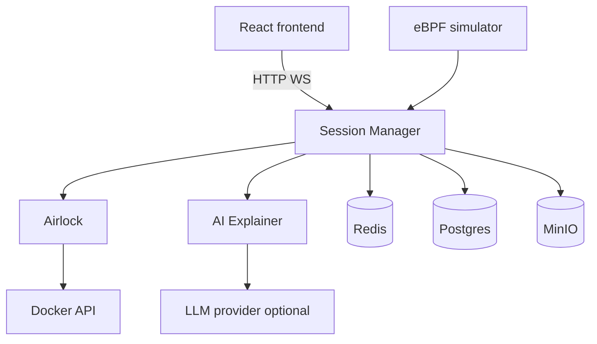
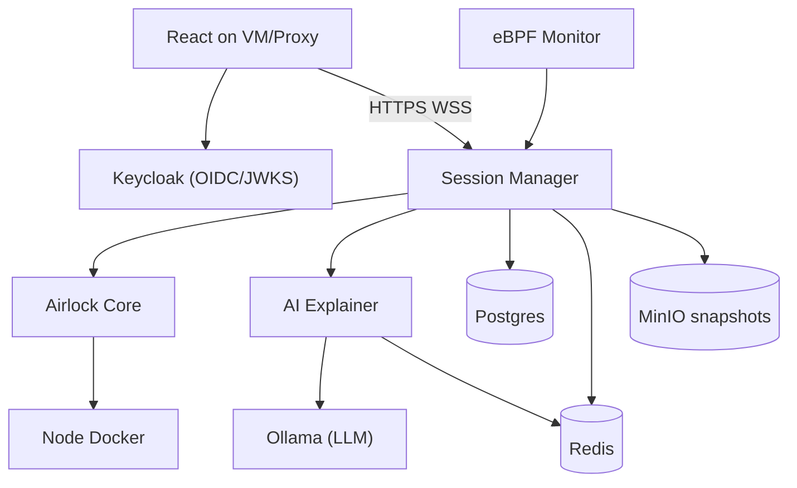

# Architecture

Maps current implementation to the PRD target. See [docs/design.md](design.md) for the full specification and [ROADMAP.md](../ROADMAP.md) for P-stage delivery.

## Delivery decisions (locked)
- **Target:** Full free-stack production (Keycloak, Postgres, MinIO/S3-compatible, Ollama, Prometheus/Grafana/Loki, Cloudflare Tunnel).
- **Shape:** Session Manager, Airlock Core, AI Explainer, eBPF Monitor (DaemonSet).
- **WebSocket:** Session Manager only; internal HTTP to Airlock and AI.

## Current local implementation

Compose runs the React frontend, Session Manager, Airlock, AI Explainer, eBPF
simulator, PostgreSQL, Redis, and MinIO.

## Free-stack production architecture

## Repo layout

| Path | Role |
|------|------|
| `services/session-manager/` | HTTP + WS, OIDC/JWT validation, lifecycle, snapshots |
| `services/airlock/` | Docker exec, spawn, timeout kill |
| `services/ai-explainer/` | LLM stream, cache, rate limit |
| `services/ebpf-monitor/` | Kernel events, dedup, ingest to SM |
| `pkg/` | Shared WS types, internal clients, DB |
| `infra/` | Deploy scripts for the chosen deployment target |
| `k8s/` | Kubernetes manifests (optional) |
| `frontend/` | React + auth adapter |

## Gap table (MVP to PRD)

| Concern | Local status | Free-stack acceptance | Stage |
|---------|-------------|------------|-------|
| Service shape | Split services pass in Compose | Single-VM rollout blocked | P2, P7 |
| Auth | Guest pass; Keycloak/OIDC code under integration | Real sign-in blocked | P8 |
| Timeout kill | SIGTERM + 5s + SIGKILL pass | VM runtime blocked | P3 |
| Snapshots | MinIO save/restore pass | Snapshot delivery blocked | P4 |
| Session end | Summary, queue, and grace pass | Prometheus/Loki delivery blocked | P5 |
| Viz | Panic, OOM, and segfault states pass | Browser performance unverified | P6 |
| eBPF | Simulator pass; Linux image builds | Linux probe run blocked | P7 |
| Resilience | Circuit breakers and retries pass | Managed outage tests blocked | P9 |
| Infra | Compose validates | VM bootstrap blocked | P10 |
| Ops | Metrics, alarms, scaling validate | Live dashboard/alert test blocked | P11 |
| Frontend host | Production build passes | Public URL via tunnel blocked | P12 |

## Local development

Compose runs all services plus PostgreSQL, Redis, and MinIO.

- UI: `http://localhost:3000` (nginx proxies `/health`, `/api`, `/ws`)
- Session Manager host publish: `http://127.0.0.1:8082` (container port `8080`)
- Vite: `http://127.0.0.1:5175` proxies `/api` and `/ws` to Session Manager `8082`

Operator checklist: `docs/local-ops.md`.
